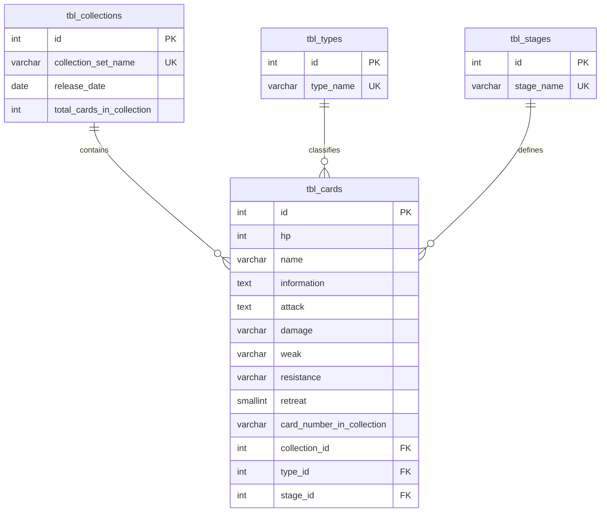

# Pokémon Trading Card Collection Database

A relational database project developed with **PostgreSQL** and **Microsoft Copilot** to organise Pokémon Trading Card data, manage collection records, and build a foundation for SQL-based data analysis.

> **Project status:** Database design, table creation, sample data seeding, and a consolidated card view are documented in this project. Analytical reporting and dashboard development can be added as future stages.

## 1. Project Overview

The goal of this project is to design and implement a database for storing and organising Pokémon trading cards by collection, Pokémon type, and evolution stage.

The project uses Microsoft Copilot as an AI-assisted development tool to help formulate SQL prompts, generate SQL scripts, and support the development process. The generated SQL is reviewed and adapted as part of the learning process.

The card attributes modelled include:

- HP (Hit Points)
- Pokémon name
- Card information and description
- Attack and damage
- Weakness and resistance
- Retreat cost
- Card number within its collection
- Collection, type, and evolution stage

The initial examples in the supplied seed data use the **Base Set** and **Jungle Set** from the physical Pokémon Trading Card Game. These examples should not be described as verified Pokémon TCG Pocket card data without checking the Pocket card catalogue and its specific attributes.

## 2. Project Objectives

- Design a relational database for Pokémon card collection data.
- Separate collections, Pokémon types, evolution stages, and card details into related tables.
- Apply primary keys, foreign keys, constraints, and indexes.
- Populate the database with sample records using SQL seed scripts.
- Create a database view that combines card information with descriptive values from related tables.
- Use Microsoft Copilot to assist with SQL development and prompt-based problem solving.
- Prepare structured data for future analysis, reporting, and visualisation.

## 3. Tools and Technologies

| Tool / Technology | Purpose |
|---|---|
| PostgreSQL | Relational database management system |
| SQL | Database creation, data insertion, relationships, and views |
| Microsoft Copilot | AI-assisted SQL generation and query development |
| PowerShell | Intended support for combining SQL scripts into a migration file |
| GitHub | Source-code versioning and project documentation |

## 4. Database Design

The database is organised into four main tables.

| Table | Purpose |
|---|---|
| `tbl_collections` | Stores collection names, release dates, and total card counts |
| `tbl_types` | Stores Pokémon card types |
| `tbl_stages` | Stores evolution stages |
| `tbl_cards` | Stores card attributes and references the related collection, type, and stage |

### Entity relationships



### Data integrity and database structure

The schema applies several relational database principles:

- **Primary keys:** Each table has an automatically generated identifier.
- **Foreign keys:** Card records reference their collection, type, and stage.
- **Unique constraints:** Collection names and type/stage names cannot be duplicated. A card number must also be unique within its collection.
- **Check constraints:** HP, retreat cost, and the total number of cards cannot be negative.
- **Indexes:** Indexes are created for the card table's collection, type, and stage foreign-key columns.
- **Referential integrity:** Foreign-key actions help protect relationships when referenced records are updated or deleted.

## 5. Data Population and Seed Scripts

The database is populated through SQL `INSERT` statements.

The seed-data development was performed in stages:

1. Insert the initial collection, Pokémon types, and evolution stages.
2. Insert an initial group of Pokémon card records.
3. Generate 30 additional sample records.
4. Generate another 50 sample records.
5. Add the Jungle Set collection and its sample card records.

The scripts use `ON CONFLICT DO NOTHING` to avoid inserting records that would violate the relevant unique constraints.

The seed data provides a practical dataset for testing relationships, joins, filtering, aggregation, and data-quality checks.

**Data-quality consideration:** AI-generated sample data should be validated against a reliable card source before being treated as an authoritative catalogue. Descriptions, attacks, HP, card numbers, weaknesses, resistances, and collection totals may need verification.

## 6. SQL View

A view named `vw_pokemon_cards` combines the card table with its related collection, type, and stage information.

The view uses:

- `INNER JOIN` to retrieve the associated collection.
- `LEFT JOIN` to retrieve type and stage descriptions while allowing for optional references.
- Explicit column selection rather than `SELECT *`.

This creates a more convenient, denormalised read structure for querying card information without repeatedly writing the same joins.

Example:

```sql
SELECT
    id,
    hp,
    name,
    information,
    attack,
    damage,
    weak,
    resistance,
    retreat,
    card_number_in_collection,
    collection_set_name,
    release_date,
    total_cards_in_collection,
    type_name,
    stage_name
FROM vw_pokemon_cards;
```

## 7. Data Analysis Opportunities

The current database structure provides a foundation for exploring the collection through SQL. The following are potential analytical questions for future development; they should not be interpreted as completed reports unless corresponding queries and results are added.

| Analysis area | Example question |
|---|---|
| Collection overview | How many cards are registered in each collection? |
| Pokémon types | Which types have the highest number of cards? |
| Evolution stages | How are cards distributed across Basic, Stage 1, and Stage 2? |
| HP analysis | What are the average, minimum, and maximum HP values by type? |
| Attack analysis | Which attack names and damage values appear most frequently? |
| Weakness analysis | Which weaknesses are most common across the dataset? |
| Collection completeness | How many registered cards are there compared with each collection's stated total? |

Possible SQL techniques for these analyses include `COUNT`, `AVG`, `MIN`, `MAX`, `GROUP BY`, `ORDER BY`, filtering with `WHERE`, and joining related tables.

## 8. Database Script Organisation and Migration

The project also explores consolidating multiple SQL scripts into a single migration file using PowerShell.

The intended workflow is to:

1. Identify the directory containing the SQL scripts.
2. Read the scripts in a predictable order.
3. Combine their contents into a migration file.
4. Execute the resulting SQL against the PostgreSQL database.

**Implementation note:** The PowerShell example developed during the project needs correction before it can be considered operational. In particular, the supplied snippet contains misspelled or invalid command names and a `.sqp` extension instead of `.sql`. Also, `GO` is a SQL Server batch separator, not a PostgreSQL command. A PostgreSQL-compatible migration workflow should be used.

## 9. Skills Developed

### Database development
- Relational database modelling
- Table creation and schema design
- Primary keys and foreign-key relationships
- Referential integrity and database constraints
- Index creation
- Database views and joins

### SQL and data handling
- Writing `CREATE TABLE` statements
- Writing multi-record `INSERT` statements
- Using subqueries to retrieve related identifiers
- Handling conflicts with `ON CONFLICT`
- Combining data using `INNER JOIN` and `LEFT JOIN`
- Selecting explicit columns from database views
- Preparing datasets for aggregation and analysis

### Data analysis
- Identifying useful attributes and dimensions in a dataset
- Structuring data to support analytical questions
- Defining potential KPIs and data-quality checks
- Exploring categorical and numerical attributes
- Preparing a relational dataset for reporting and visualisation

### AI-assisted development
- Writing structured prompts for Microsoft Copilot
- Using AI to support SQL script generation
- Refining prompts to request additional seed records
- Reviewing and validating AI-generated SQL
- Using AI as a development assistant rather than treating generated output as automatically correct

### Automation and documentation
- Understanding SQL script execution order
- Exploring PowerShell-based script consolidation
- Documenting database structures and development decisions
- Using GitHub to maintain and present a technical project

## 10. Learning Outcomes

This project demonstrates the process of transforming a collection-management idea into a structured relational database.

It provides practical experience in database design, SQL development, data population, relational queries, and AI-assisted coding. It also establishes a foundation for more advanced work, including analytical SQL queries, data-quality reporting, and interactive dashboards.

An important lesson from the project is that AI can accelerate development, but generated scripts and sample data still require technical review, testing, and validation.

## 11. Future Improvements

- Validate all card records against an authoritative Pokémon card catalogue.
- Confirm whether the target dataset is the physical Pokémon TCG or Pokémon TCG Pocket, and adapt the schema accordingly.
- Add analytical SQL queries and documented results.
- Create data-quality checks for missing values, duplicate records, and collection completeness.
- Develop a dashboard using a suitable data visualisation tool.
- Implement a repeatable PostgreSQL migration process.
- Add database backup and restore instructions.

## 12. Repository Structure

A suggested repository structure is:

```text
pokemon-card-database/
│
├── README.md
│
├── sql/
│   ├── 01_create_tables.sql
│   ├── 02_seed_reference_tables.sql
│   ├── 03_seed_base_set.sql
│   ├── 04_seed_additional_cards.sql
│   ├── 05_seed_jungle_set.sql
│   └── 06_create_views.sql
│
└── scripts/
    └── build_migration.ps1
```

Adjust the filenames and folders to match the actual files committed to the repository.

---

**Project focus:** PostgreSQL · SQL · Data Analysis Foundations · Relational Database Design · Microsoft Copilot · AI-Assisted Development

## Main Page:

 - https://github.com/WanderBernardo/DataAnalysis.git
